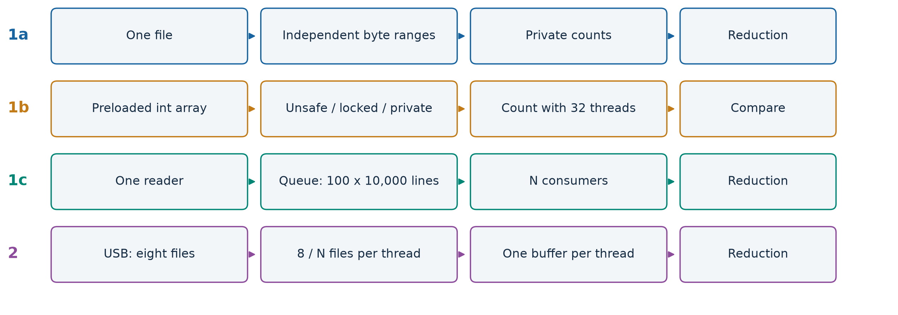
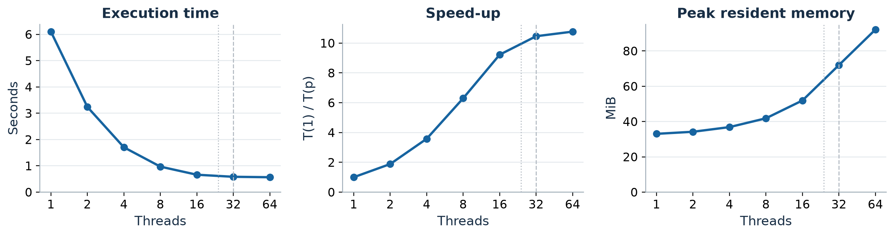
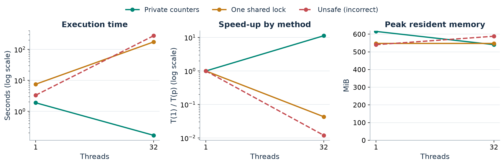
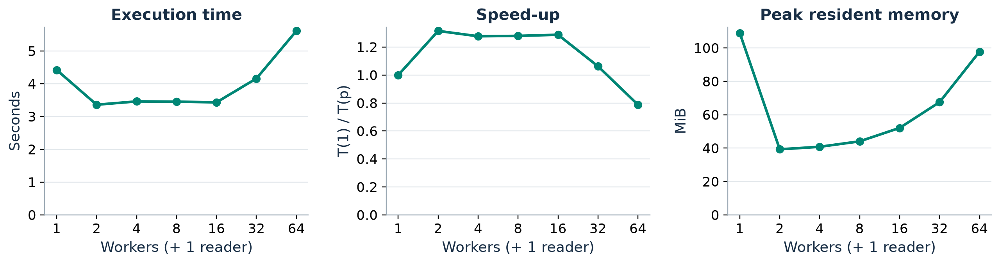
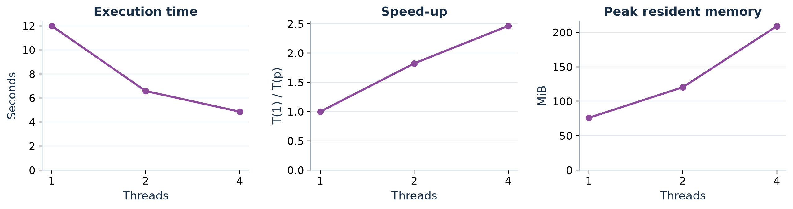
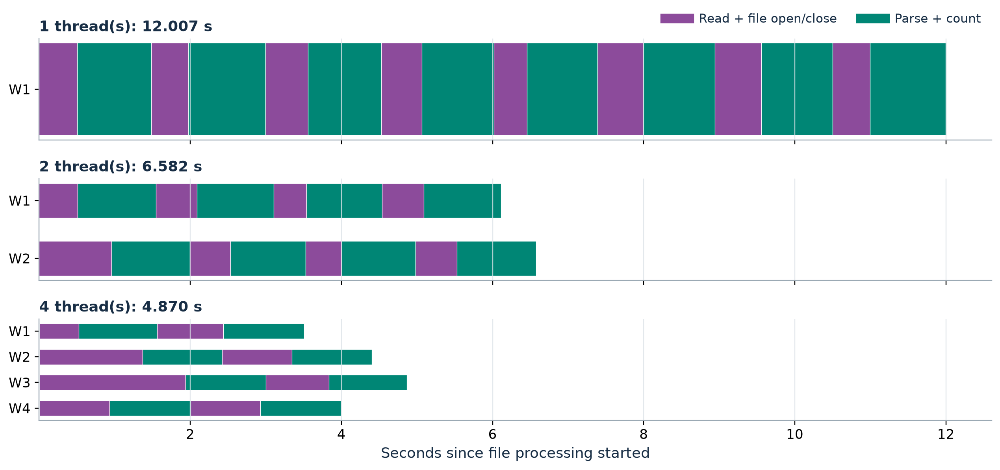
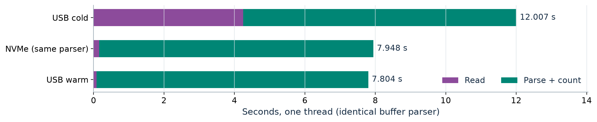
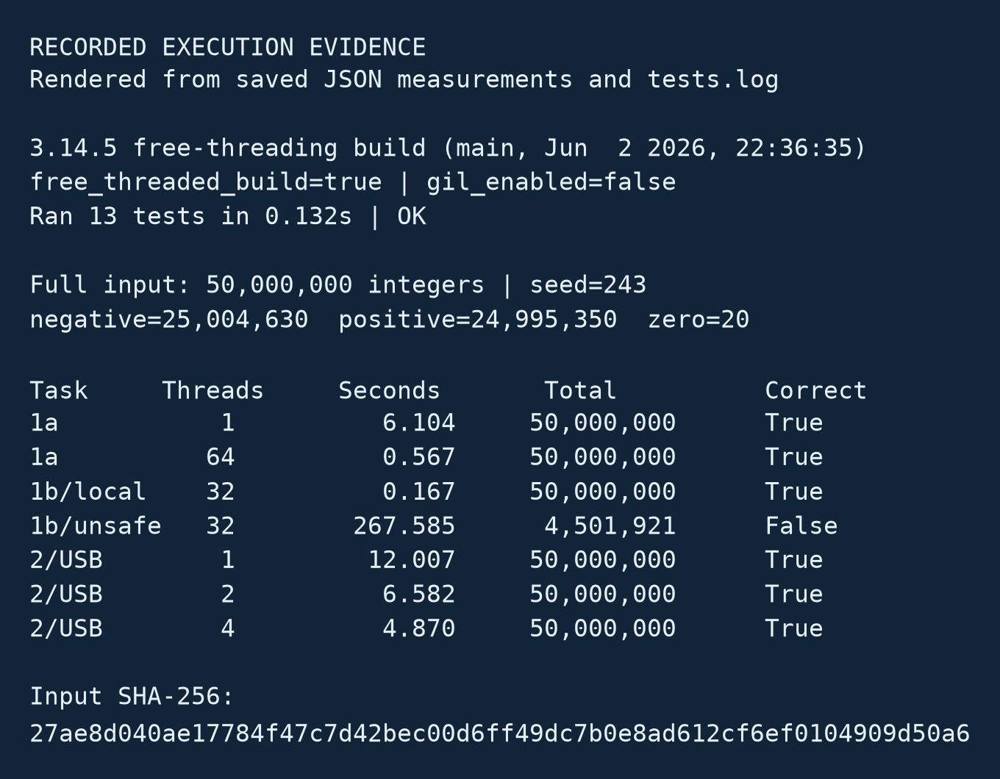

# Laboratory Work 1: Concurrency in Practice

|  |  |
| --- | --- |
| Author: | Rustem Cimendur |
| Group: | FAF-243 |
| Verified: | Cristofor Fistic, asist. univ. |
| Implementation | Python - OS threads - free-threaded CPython |
| Measurement date | 22 October 2026 |

A measured comparison of independent file partitions, shared counters, a bounded producer-consumer queue, and cold reads from USB storage.

Source code and reproducibility materials:

[GitHub repository](https://github.com/fxmidaaa/faf_network_programming)

50,000,000 values | 24 physical cores | 32 logical processors

## 1. Environment and input

| Component | Recorded configuration |
| --- | --- |
| Computer | Lenovo 82WR |
| CPU | Intel Core i9-13900HX; 24 physical cores, 32 logical processors |
| RAM | 31.81 GiB reported by Windows (32 GiB installed class) |
| Internal storage | Samsung MZVL21T0HCLR-00BL2, approximately 1 TB, NVMe SSD; C:, NTFS |
| USB storage | Transcend StoreJet, approximately 2 TB, external USB HDD; D:, NTFS; UAS driver |
| USB version | Device descriptor bcdUSB=0x0310 (USB 3.1); operating at SuperSpeed, not SuperSpeedPlus |
| OS | Windows 11 Pro, 64-bit, build 26200 (10.0.26200) |
| Counting runtime | CPython 3.14.5, 64-bit free-threading build; GIL disabled in every measurement |
| Power plan | Windows Balanced; no fixed CPU frequency or core affinity imposed |

USB information was obtained from the actual device descriptor and Windows EX_V2 connection flags. The host controller's version alone would not establish the connected device's protocol. The storage substitution from a flash stick to the student's external HDD was accepted by the student before execution.

### Dataset and independent reference

numbers.txt contains exactly 50,000,000 uniformly generated integer draws from -1,000,000 through 1,000,000, inclusive, one ASCII value per LF-terminated line. The generator is random.Random(243).randint; its counters are recorded while generating the file, independently of the counting tasks.

| Negative | Positive | Zero | Total | File size |
| --- | --- | --- | --- | --- |
| 25,004,630 | 24,995,350 | 20 | 50,000,000 | 369,449,238 B (352.33 MiB) |

The eight Task 2 files contain 6,250,000 values each in original order. Their concatenated hash matches numbers.txt; all eight USB copies were verified before the first physical reconnect.

SHA-256: 27ae8d040ae17784f47c7d42bec00d6ff49dc7b0e8ad612cf6ef0104909d50a6

## 2. Program and measurement method

### One command-line program

lab.py selects every task and configuration through arguments. It uses threading.Thread, threading.Lock, queue.Queue, and a compact array('i'). No process pool, NumPy counting, or synthetic sleeping workload is used. Task 1b workers hold non-copying views into the same preloaded integer array.

### Timing and CPU work

Each configuration runs sequentially in a fresh process. Wall time uses perf_counter() and includes thread creation, execution, joining, and final reduction. Task 1b loading is excluded and recorded separately. Generation, splitting, JSON output, and plotting are excluded. Process CPU time covers the same interval; CPU seconds / wall seconds estimates average core use.

### Peak memory and speed-up

Memory is the Windows process-lifetime PeakWorkingSetSize, including the interpreter, buffers, thread state, allocator-retained pages, and Task 1b preload. It is resident memory, not reserved thread stack address space. Because it is a lifetime maximum, a transient array resize during the untimed preload may still determine the reported peak. MiB means 2^20 bytes.

Speed-up is S(p)=T(1)/T(p), within one task and counting method. Extra one-thread Task 1b baselines make that definition possible. Task 1c's p counts consumers and excludes its one extra reader. Unsafe speed-up is a timing diagnostic only: an incorrect count is not useful completed work.

### Cache protocol and scope

Local measurements use the normal OS cache, warmed by input preparation. Every required USB configuration follows safe ejection, physical unplugging, and reconnection. Input hashes are never read between reconnect and timing. One observation is collected per required configuration, except three unsafe Task 1b repetitions. There are no statistical error bars from single observations.

## 3. Task 1a - independent file partitions

| Threads | Time, s | Speed-up | Peak, MiB | Avg. CPU cores |
| --- | --- | --- | --- | --- |
| 1 | 6.104 | 1.00x | 33.0 | 1.00 |
| 2 | 3.238 | 1.88x | 34.2 | 1.95 |
| 4 | 1.705 | 3.58x | 36.8 | 3.96 |
| 8 | 0.969 | 6.30x | 41.8 | 7.77 |
| 16 | 0.662 | 9.22x | 51.9 | 14.43 |
| 32 | 0.583 | 10.46x | 72.0 | 25.44 |
| 64 | 0.567 | 10.77x | 92.1 | 25.67 |

### 1. Where does speed-up stop growing?

Most scaling is obtained by 16-32 threads. The recorded minimum is 64 threads; going from 32 to 64 changes time from 0.583 to 0.567 s (2.9% less time). This is a plateau compared with earlier gains. A single run cannot establish a reliable small advantage. The 24 physical cores and 32 logical contexts limit useful parallel execution; logical contexts are not equally powerful cores.

### 2. Do 32 and 64 threads help?

In this particular task they still improve the recorded time slightly; it would be incorrect to claim that they necessarily slow it down. At 64, oversubscription adds scheduling and startup costs without doubling CPU capacity. The much larger slowdown in Task 1c is discussed separately.

### 3. Does peak memory depend on thread count?

Yes: 33.0 MiB at one thread versus 92.1 MiB at 64. Each reader has a 1 MiB file buffer plus Python and OS thread state. Each worker opens and aligns only its own interval; the main thread never scans the input for the workers.

## 4. Task 1b - synchronization costs

| Method | 1 thread, s | 32 threads, s | Speed-up | Peak, MiB | Correct |
| --- | --- | --- | --- | --- | --- |
| Private | 1.887 | 0.167 | 11.265x | 540.7 | Yes |
| Locked | 7.518 | 174.617 | 0.043x | 547.7 | Yes |
| Unsafe | 3.321 | 276.867 | 0.012x | 588.3 | No |

### The three required unsafe runs

| Run | Time, s | Negative | Positive | Zero | Total | Lost updates |
| --- | --- | --- | --- | --- | --- | --- |
| 1 | 267.585 | 2,252,423 | 2,249,478 | 20 | 4,501,921 | 45,498,079 |
| 2 | 293.434 | 2,211,954 | 2,212,440 | 20 | 4,424,414 | 45,575,586 |
| 3 | 269.582 | 2,242,297 | 2,225,810 | 20 | 4,468,127 | 45,531,873 |

### 4. Rank the methods and explain correctness

Recorded time ranking at 32 threads: private < locked < unsafe. Private counters and the locked version reproduce all three reference totals. The unsafe runs lose read/add/write updates and fail correctness. CPython's internal container synchronization protects individual list operations, not the whole increment. It can still create heavy contention even though the application has no explicit lock. The explicit lock serializes increments; private counters avoid per-value sharing and merge only after joining.

The integer array contains 200,000,000 bytes (190.73 MiB). The reported process peak also includes preload resizing and allocator/interpreter memory. Loading is excluded from time, not from the lifetime memory peak. This metric alone cannot attribute the difference to a particular allocation.

## 5. Task 1c - producer and consumers

| Workers | Time, s | Speed-up | Peak, MiB | Task 1a time, s |
| --- | --- | --- | --- | --- |
| 1 | 4.422 | 1.00x | 108.9 | 6.104 |
| 2 | 3.361 | 1.32x | 39.3 | 3.238 |
| 4 | 3.462 | 1.28x | 40.8 | 1.705 |
| 8 | 3.454 | 1.28x | 44.1 | 0.969 |
| 16 | 3.433 | 1.29x | 52.1 | 0.662 |
| 32 | 4.161 | 1.06x | 67.5 | 0.583 |
| 64 | 5.612 | 0.79x | 97.8 | 0.567 |

### 5. How does the pipeline compare with Task 1a?

The recorded pipeline minimum is 3.361 s with 2 consumers. One consumer takes 4.422 s, but that configuration already has two OS threads: reader and consumer. It can overlap reading with parsing. At larger counts, Task 1a is much faster because its readers parse independently. The single producer in Task 1c caps delivery; extra consumers add queue and scheduling costs. The 32- and 64-consumer results show that oversubscription can be slower.

### 6. What about one-line batches or an unlimited queue?

One-line batches would replace roughly 5,000 batch transfers with 50,000,000 queue transfers, greatly increasing synchronization and object overhead. An unlimited queue could retain most of the input as Python line objects if the reader outruns consumers. The bound applies backpressure at one million queued lines; active batches are additional to this bound.

Memory is not monotonic: the one-consumer peak is 108.9 MiB, while two consumers use 39.3 MiB. A slow consumer allows more queued lines to accumulate. At high worker counts, additional thread state and active batches increase the peak again.

## 6. Task 2 - cold USB reads

| Threads | Files / thread | Time, s | Speed-up | Peak, MiB | Avg. CPU cores |
| --- | --- | --- | --- | --- | --- |
| 1 | 8 | 12.007 | 1.00x | 76.0 | 0.66 |
| 2 | 4 | 6.582 | 1.82x | 120.4 | 1.25 |
| 4 | 2 | 4.870 | 2.47x | 209.0 | 1.75 |

### Cold-cache procedure and recorded evidence

Before each configuration the user safely ejected, physically unplugged, and reconnected the drive as instructed. A separate observer logged drive disappearance and reappearance using GetLogicalDrives without reading data. It then started a fresh measurement process after a two-second mount delay. These OS observations corroborate removal; they do not independently prove the physical action or rule out background OS activity.

| Threads | Observed absent (UTC) | Observed present (UTC) |
| --- | --- | --- |
| 1 | 19:35:10 | 19:35:17 |
| 2 | 19:36:42 | 19:36:49 |
| 4 | 19:37:48 | 19:37:54 |

### Questions: storage limits and useful concurrency

USB with one thread takes 12.007 s; Task 1a on the internal SSD takes 6.104 s (1.97 times as long). This ratio alone does not prove I/O dominance: Task 2 uses a whole-buffer parser and a cold HDD, whereas Task 1a uses buffered lines and a warm NVMe file. The next page separates read time from parsing and adds matched controls.

The best observed USB configuration uses 4 thread(s), with speed-up 2.47x. More threads do help in the measured range: Python parsing runs in parallel and reading can overlap other workers' parsing. This does not mean that the disk itself supplies proportionally more bandwidth. Concurrent readers share one HDD mechanism, controller, and USB link; additional streams may add seeks and cannot multiply its bandwidth. Independent network waits can overlap without sharing that single disk mechanism, which explains why the lecture's I/O example need not predict the same scaling here.

Each part is approximately 44 MiB. A worker releases its file buffer before reading its next file, so at most one whole-file buffer per worker is live. Increasing the thread count therefore increases concurrent buffer memory even when it does not improve storage throughput.

## 7. Where the USB time goes

In the one-thread cold run, reading/opening/closing totals 4.250 s (35.4% of the read-plus-parse stages), and parsing/counting totals 7.754 s (64.6%). Average process core use is 0.66. Read calls include both transfer work and waiting; parse intervals measure Python computation. At one thread, these non-overlapping stages provide stronger evidence than a cross-task wall-time comparison.

This Python workload remains predominantly parsing/CPU-limited at one thread, despite using a cold external HDD. Storage still contributes a measurable cost and can become limiting when several readers compete. At four threads, the last-finishing worker spends 2.769 s reading and 2.093 s parsing: the critical path becomes mixed, with a larger storage-wait contribution as parsing is parallelized.

Controls are diagnostic additions, not replacements for cold USB runs. The local control reads the same eight parts on NVMe; the warm USB control follows the completed cold campaign without another reconnect. Per-file timings are wall-clock stages, not hardware disk-busy counters, so they cannot isolate controller latency, seek time, OS readahead, or device-internal cache.

## 8. Correctness and execution evidence

| Configuration group | Runs | All three counters match? |
| --- | --- | --- |
| Task 1a: all thread counts | 7 | Yes |
| Task 1c: all worker counts | 7 | Yes |
| Task 1b: one-thread baselines | 3 | Yes |
| Task 1b: 32-thread lock / private | 2 | Yes |
| Task 1b: 32-thread unsafe | 3 | No; lost updates recorded explicitly |
| Task 2: three cold USB configurations | 3 | Yes |

Every accepted counting result has negative=25,004,630, positive=24,995,350, zero=20, and total=50,000,000. Checking only the sum would be insufficient: a skipped value and a duplicate could cancel. Incorrect unsafe outputs are retained as the required race experiment.

The 13 automated tests cover every possible two-way byte cut in an adversarial small file, more threads than lines, LF/CRLF and a missing final newline, array loading, protected counters, bounded queue draining, worker failures, whole-buffer parsing, eight-file assignment, ordered splitting, and a controlled lost update. The controlled demonstration is separate from all benchmarks.

## 9. Control questions

### 1. Physical core versus logical processor

A physical core is hardware that executes instructions. A logical processor is an OS scheduling context; simultaneous multithreading can expose more than one context per core. This machine reports 24 physical cores and 32 logical processors. Task 1a flattens around the top end of that range; its recorded minimum is at 64 threads. Task 1c instead stops improving near 2 consumers because its producer, rather than the available core count, limits delivery.

### 2. How are partition boundaries made correct?

A worker with nonzero start examines byte start-1. If that byte is LF, start already begins a line. Otherwise the worker skips the rest of the partial line. It then counts complete lines whose starting position is strictly below end. A line crossing end belongs to the earlier worker; the following worker skips its remainder. No central thread reads the file on behalf of the workers. Exhaustive small-file boundary tests verify this.

### 3. How do unsynchronized counters lose updates?

A reads 0; B reads 0; A computes and writes 1; B computes and writes 1. Two values were counted but the stored counter increased only once. The read/add/write sequence must be protected as a unit. The large unsafe runs use natural scheduling, while the separate two-thread barrier example forces exactly this order and produces 1 instead of 2.

### 4. Why are per-thread counters faster than a mutex?

Private counters have no competing writers in the counting loop. Only three values per worker are merged after joining. A shared mutex permits one increment at a time and adds lock acquisition, wake-up, and cache ownership costs. Removing the GIL permits parallel execution; it does not remove contention introduced by the algorithm.

### 5. I/O-bound USB versus a server waiting on the network

I/O-bound work spends its critical path waiting for external data. Many reads on one HDD compete for a shared spindle, head, controller, and link. Independent network requests can overlap remote waits and use different resources. Concurrency helps when independent waiting and unused capacity exist. The measured read/parse fractions determine whether this particular USB program is actually I/O-dominated; the mere presence of a USB drive does not.

### 6. Static partitions versus a queue

Static partitioning assigns predictable work once and avoids a central handoff. It works well for similarly sized uniform tasks. A queue distributes work dynamically, balances uneven durations, and overlaps pipeline stages, but introduces communication and synchronization. A bounded queue limits backlog and provides backpressure. Here uniform file partitions scale better than a pipeline with one reader.

## 10. Conclusions and reproducibility

On this machine, warm internal-file counting is predominantly CPU/parsing work: Task 1a improves from 6.104 s at one thread to 0.567 s at 64 threads. The gain approaches a plateau rather than continuing in proportion to thread count. Oversubscription is not a substitute for additional physical cores.

The producer-consumer implementation reaches its minimum at 2 workers (3.361 s); its single reader and queue become the limiting stage. Shared-counter experiments show that free threading does not ensure correctness or good scaling. Private counters return the correct result in 0.167 s at 32 threads; the unsafe method loses updates and synchronization introduces a cost.

This Python workload remains predominantly parsing/CPU-limited at one thread, despite using a cold external HDD. Storage still contributes a measurable cost and can become limiting when several readers compete. At four threads, the last-finishing worker spends 2.769 s reading and 2.093 s parsing: the critical path becomes mixed, with a larger storage-wait contribution as parsing is parallelized.

### Limits of these measurements

This is one machine, one seeded dataset, one recorded campaign, a Balanced power plan, and a heterogeneous mobile CPU. Turbo behavior, thermal state, background work, filesystem readahead, and device-internal caching were not independently controlled. Most points have one observation, so small differences and universal thread-count recommendations are not justified. A flash stick may behave differently from the measured external HDD.

### Reproduce and inspect

The repository README gives exact commands for generation, splitting, every task, tests, cold USB runs, and report rebuilding. The suite uses a fresh process per configuration. Each measurement records counters, timing, peak memory, runtime/GIL state, input hash, and counting-source hash. summary.csv provides the chart data. DEFENSE.md explains the key code paths.

### References

Assignment: Laboratory Work 1: Concurrency in Practice, provided four-page handout.

- [Python free threading](https://docs.python.org/3.14/howto/free-threading-python.html)
- [Blocking queue and shutdown](https://docs.python.org/3.14/library/queue.html)
- [Compact integer arrays](https://docs.python.org/3.14/library/array.html)
- [Windows peak working set](https://learn.microsoft.com/en-us/windows/win32/api/psapi/ns-psapi-process_memory_counters)
- [USB connection version](https://learn.microsoft.com/en-us/windows-hardware/drivers/ddi/usbioctl/ni-usbioctl-ioctl_usb_get_node_connection_information_ex_v2)
